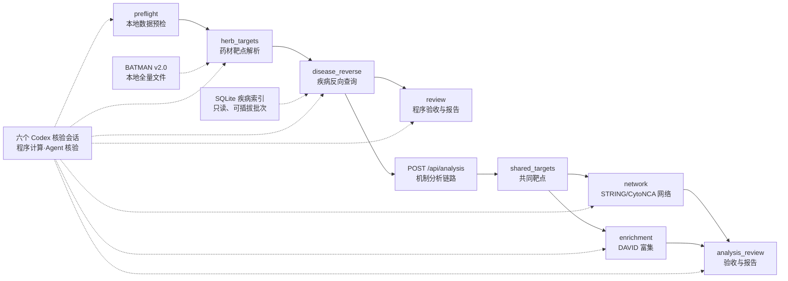

# Pharmacology Multi-Agent

中药复方 → BATMAN 本地成分/靶点 → 本地疾病索引反查候选疾病的可追溯研究工具。输入一个方剂（或自由药材组合），程序在本地数据中解析药材—成分—靶点关系，再用本地 SQLite 疾病索引反查"哪些疾病与这些靶点有关联"，输出候选疾病与逐条证据及透明启发式置信度。工作台顶部另提供正向 Agent 对话框，可直接输入内置方剂名（如温经汤，自动展开 12 味药材）或药材名，调用本地 BATMAN、Open Targets 和 Monarch 查询候选疾病。对候选疾病可继续做机制分析：共同靶点 → STRING/CytoNCA 网络 → DAVID 富集 → 验收。

核心原则：**能本地化的全部本地化**——主链路是确定性程序；本地数据缺失时明确 blocked 并给出指引，不用合成数据顶替。**多 Agent 编排层**：live 运行默认启用六个独立 Codex 会话（协调/药材靶点/疾病发现/网络/富集/验收），程序做全部计算，Agent 只做核验与解释、结论不改程序产物。第三阶段默认查询 Open Targets 本地快照，只有显式指定 `online` 才调用 GraphQL；结果生成运行专用疾病索引；GeneCards/OMIM 采集与人机协助已于 2026-10-01 移除。

首页现已支持双向查询：方剂/药材 → 候选疾病，以及疾病 → 靶点 → 成分 → 候选关联药材。可输入“查询肺腺癌关联哪些药材”，或用输入框上方的方向选择。反向采用 BATMAN known-only，疾病歧义先选择，支持证据、疾病靶点、匹配指标追问及 JSON 导出；与正向共用任务接续、关闭取消和历史功能。详见 [疾病到药材查询](docs/DISEASE_TO_HERB.md)。反向使用透明匹配数量和覆盖率，不沿用正向启发式评分，不构成治疗推荐。

## 快速启动

正向新查询分开显示疾病大类和具体候选，默认按原支持度排序；背景校正作为辅助列与可切换的探索性Top-K，证据、原排序及两种列表随结果保留。新指标科学有效性尚待验证，详见 [正向排序说明](docs/FORWARD_RANKING.md)。

2026-10-15：会话查询已加入实际阶段、分片/行数和耗时显示；Open Targets 在 Arrow 中先筛选再解析，相同输入与数据/代码版本的成功查询可复用本地完整结果缓存，每次仍生成新归档并标注原计算。缓存不覆盖原始证据、失败不复用；详见 [查询加速与进度](docs/QUERY_EXECUTION.md)。更新后由用户在现有终端停止并重启服务以加载后端。

以下步骤面向首次克隆仓库的开发者，使用 **Windows PowerShell**，建议 Python 3.11。不需要任何研究数据、账号或模型服务即可完成 fixture 验证。

### 1. 获取项目并安装依赖

```powershell
git clone https://github.com/HappyLifeToCode/PharmacologyMultiAgent.git
cd PharmacologyMultiAgent
python -m venv .venv
.\.venv\Scripts\python.exe -m pip install --upgrade pip
.\.venv\Scripts\python.exe -m pip install -r requirements.txt
.\.venv\Scripts\python.exe -m playwright install chromium
```

命令直接使用项目内的虚拟环境，无需激活脚本。已有 Python 环境也可使用，替换解释器路径即可。

### 2. 启动工作台

```powershell
.\.venv\Scripts\python.exe server/app.py --port 8766
```

打开 [本机对话首页](http://127.0.0.1:8766)。服务仅监听本机。也可使用 `scripts/start_demo.ps1`。原任务、运行和机制分析界面保留在 [研究工作台](http://127.0.0.1:8766/workbench)。

对话首页支持输入“帮我看看温经汤关联哪些候选疾病”或实际药材清单，Enter 发送、Shift+Enter 换行。结果内可展开药材组成、逐条证据和评分组成；支持“展开第一个疾病的证据”“查看药材组成”“解释匹配支持度”等固定追问。侧栏可新建、搜索和切换会话，查询设置可调整返回数量和 BATMAN 阈值。会话文字与运行编号保存在当前浏览器，结果从本机归档读取，可导出 JSON；清除浏览器数据会丢失会话列表，不删除研究归档。当前不是通用语言模型聊天，不自动执行机制分析。

首页及工作台顶部的正向对话支持本地方剂组成表 `data/batman/v2.0/formula_browse.txt`（目录沿用 BATMAN 配置）。可直接输入“四物汤”等收录名称或自然问句；同名同组成的记录合并，不同组成先展示药材清单供选择或编辑，确认后才查询靶点和候选疾病。勾选“记住这份组成”后保存为本机默认，后续复用；数据版本变更后重新核对。输入方剂名后点击“选择/修改组成”可更换默认，或恢复候选原组成。原温经汤、半夏白术天麻汤、济川煎、桃核承气汤保留既有组成和候选规则，旧任务面板下拉也仍为这四方。未收录方剂或加减方需提供实际药材组合。

方剂表仅有中文名、拼音名和药材拼音组成，没有出处或剂量，不自动认定某条为标准方。新增药材映射采用精确名称和明确列出的项目常用简称，保留原名和映射说明；不模糊猜测芍药类别或替代炮制形式。未匹配项允许编辑，或明确按已匹配部分继续，结果仍列出未匹配药材。选择及修改是研究输入记录，不是科学复核签字。

结果显示展开的药材清单、每味药材的 BATMAN 检索候选与实际命中名、成分及靶点关系数，并展示候选疾病、匹配靶点、来源证据和 `heuristic_v2` 排序分数。该分数不是治疗有效率或疗效概率。首页称其为“匹配支持度”，可查看逐条 Open Targets/Monarch 证据；原工作台顶部查询也继续保留。

疾病名称后追加中文，例如 `breast cancer（乳腺癌）`；首页候选、证据、评分组成和工作台使用同一本地词表，旧结果刷新后也能显示，无需重新查询。词表包含 Wikidata 按 MONDO ID 精确匹配的中文标签及项目常用译名，未收录时显示“中文名未收录”；翻译不修改疾病 ID、评分、排序或历史归档，导出 JSON 保留原研究结果。维护方式见 [数据契约](docs/DATA_CONTRACT.md#中文疾病名称展示)。

点击正向候选“查看证据”，可用交互图追溯“药材 → 成分 → 靶点 → 候选疾病”，按靶点与来源浏览并下载当前分组的SVG。节点和连线对应归档中的记录，旧数据缺失路径会明确提示；原证据表及排名保留。用法见[证据图说明](docs/EVIDENCE_VISUALIZATION.md)。

正向查询设置可选“使用已保存的知网论文辅助检索”，默认关闭。启用后读取本项目`data/cnki`的标题摘要，展示全部可追溯的文献关联，不设Top-N，不改变现有篇数排序及原数据库排序；旧结果也可点“读取已有知网文献”，无须重新研究查询。所需数据和采集代码已迁入本项目，不再依赖旧UI-Agent文件夹。独立采集CLI默认用Codex `gpt-5.6-luna`遍历关键词全部结果页，只关注标题摘要，显式`--execute`才启动。网页不会自动联网采集；独立数据包及命令见[交付说明](docs/CNKI_DELIVERY.md)，当前验证范围见[接入说明](docs/CNKI_INTEGRATION.md)。

正向 API 的每条查询在独立进程计算。**在项目内切换对话、进入工作台、切换标签或刷新页面，继续同一条查询；关闭承载查询的页签后约 10 秒停止对应查询**，保留中间记录。页面使用同一页签编号和持续连接接续任务，返回后按请求编号恢复，不重复提交。连接报错可“恢复原查询”；主动“重新查询”会先停止上一条，再从头启动新的，目前不提供中断点续算。研究工作台链接在新标签页打开；已完成归档读取失败时可点“重新读取结果”，只读归档。更新后需按原命令重启服务一次。

### 3. 用 fixture 验证流程（无需数据）

在 `/workbench` 左侧"新建任务"选择一个内置方剂（如温经汤），运行方式选 **fixture（合成工程验证）**，点击"保存并启动"。数秒后四阶段全部 succeeded：中间栏阶段图变绿，点击"疾病反向查询"节点可在右栏看到候选疾病表与逐条证据。fixture 使用固定合成集合，全程不访问外网、不产生药理结论。

### 4. 真实数据运行（需要数据）

live 模式需要本地 BATMAN 数据，以及本地疾病索引或启用 Open Targets 数据查询；缺失时对应阶段 blocked 并给出指引：

- **BATMAN-TCM v2.0 全量下载文件**：配置 `configs/batman_data.local.json`（模板 `configs/batman_data.example.json`）指向本机数据目录。
- **本地疾病索引或 Open Targets**：用合格批次执行 `python -m pharm.discovery.query prepare --batch <批次目录>` 建立；也可启用工作台 Open Targets 数据查询，使用 API 或本地快照生成运行专用索引（见 [导入说明](docs/IMPORTS.md)）。

live 运行默认启用多 Agent 核验（任务 `agents=true`），需要可用的 Codex CLI 与 profile（见 [Codex 执行配置](docs/CODEX_RUNTIME.md)）；环境不可用时运行会明确失败并提示改用 `agents=false`——纯程序 live 运行不需要模型服务。

### 5. 测试

```powershell
.\.venv\Scripts\python.exe -m pytest tests/ -q
```

测试不需要研究数据、真实模型或外网；多 Agent 编排用 mock 会话，Open Targets API 用合成响应、本地模式用合成 Parquet 验证。最近一次全量回归为 269 passed、3 skipped；最新结果见项目进度。

## 架构

### 正向助手：自然问句与 BATMAN 本地优先

可直接问“温经汤可能与哪些疾病有关？”；前端传递原始问句，后端从已收录方剂名称中识别唯一方剂，统一展开药材并查询成分与靶点。并非固定句式匹配，也不要求先点击方剂；多个方剂、明确加减方或被排除的方剂不会静默按原方查询。本地方剂表中的同名异方先选择组成，原四方保留内置参考组成，不由模型猜测。

正向助手首先读取已配置的本地 BATMAN 全量文件。有文件时不访问官网；本地查询空结果、药材未命中或文件损坏不等于“没有本地文件”，不会隐式切换来源。仅必需文件缺失时，复用 `local/batman/official-download-cache/` 中的官方缓存；无缓存才尝试从 BATMAN 官网下载 v2.0 known 文件并用同一解析器计算。下载先暂存、校验表头并记录官方 URL、取得时间和 SHA-256，成功后缓存供后续查询使用。页面与结果 `batman_source` 明示来源。`PHARM_BATMAN_ONLINE_FALLBACK=false` 可禁用缺失回退。

在线回退是“获取官方数据后本地计算”，不是尚未经核实的网页查询 API。自动下载依赖官网公开链接；动态页面没有可识别链接时，可在 `configs/batman_online.local.json` 的 `download_urls` 对象内配置经人工核实的 `herbs`、`known_by_ingredients`、`known_by_targets` 三个官方文件 URL。仅接受现有官方主机，不使用镜像、其他版本或合成数据；验证码、访问失败及结构不符明确阻断。本机尚未取得真实官网数据，在线成功路径仅通过合成响应测试。此次回退仅接入正向助手，既有任务流水线的数据预检仍是本地模式；疾病查询来源和评分不变。



- 两条流水线（`pharm/pipeline/scheduler.py` 注册 DAG）：discovery（四阶段反向发现）与 analysis（候选疾病的机制分析，经 POST /api/analysis 触发）。manifest.json 是唯一状态源；参数即身份（task_id 为内容哈希）、代码即签名（resume 只复用输入/代码/数据/产物哈希全一致的成功阶段）。
- **多 Agent 编排**：程序完成计算后启动对应 Codex 会话核验（提示词在 `agents/*.md`，内容哈希参与阶段签名）；Agent 报 failed 只把阶段降为 partial，程序产物不改；会话错误如实记录。
- 本地数据缺失 → 阶段 blocked + 数据配置 guidance；启用 Open Targets 查询时，第三阶段可由查询结果建库。blocked/failed 也是终态，下游如实记录。
- scientific_complete 恒为 false：关键词关联≠疗效；置信度是启发式（heuristic_v2）而非统计检验；零结果如实保留。

## 目录结构

```text
pharm/            全部运行时代码
  core/           公共基础（路径/IO、归档、导入校验、符号校验）
  agents/         Codex 会话适配器（多 Agent 核验层）
  batman/         BATMAN 本地数据查询、全药材目录扩展、内置四方剂组成表
  diseases/       Open Targets API/快照、Monarch 本地证据与通用关联批次建库
  agent/          正向药材→靶点→候选疾病查询
  discovery/      疾病索引（建库/查询/目录）与反向查询
  network/        STRING 本地/API 网络、CytoNCA 桥、NetworkX 度值核对
  enrich/         DAVID 网页接口富集适配
  pipeline/       任务模型、DAG 调度器（双流水线）、执行引擎
agents/           六个核验角色提示词（引擎实际使用）与说明
integrations/     CytoNCA 桥接插件源码（机制分析可选）
server/           本机 Web 工作台（FastAPI + 静态单页）
scripts/          任务执行、环境检查、桥接构建、报告导出入口
configs/          可共享执行设置与本机配置模板，不含凭据
tasks/            任务模板与填写说明；个人任务保存在 Git 忽略文件
docs/             协作、接口与实施文档
tests/            全部自动测试
data/ runs/ reports/ local/   运行生成或本机私有内容，默认不提交 Git
```

## 文档导航

| 文档 | 内容 |
|---|---|
| [完整文档导航](docs/README.md) | 阅读顺序与维护约定 |
| [项目进度与问题清单](docs/PROJECT_STATUS.md) | 已实现能力、缺口与下一步 |
| [启动与使用](docs/QUICKSTART.md) | 页面操作、恢复、离线报告 |
| [交接说明](docs/HANDOVER.md) | 架构、关键资产、已知坑、待办 |
| [反向查询与疾病索引](docs/REVERSE_DISCOVERY.md) | 索引口径、建库、查询接口 |
| [数据导入说明](docs/IMPORTS.md) | 通用批次与 Open Targets 快照的校验纪律 |
| [数据交接约定](docs/DATA_CONTRACT.md) | 双流水线产物、状态语义、归档布局 |
| [环境准备](docs/ENVIRONMENT_SETUP.md) | 软件、浏览器与数据来源准备 |
| [Codex 执行配置](docs/CODEX_RUNTIME.md) | 多 Agent 核验层的模型会话配置（live 默认启用） |
| [任务模板](tasks/tasks.example.jsonl) / [填写说明](tasks/README.md) | 任务字段与示例 |

## 历史

本项目此前是"药物×疾病交集分析"方向的多 Agent 系统（Venny 交集、STRING/CytoNCA 网络、DAVID 富集、甲状腺五病案例、六角色九阶段）。该方向已于 2026-09-22 重构废弃：相关代码（venny、string_local、cytoscape、david、supplement、audit 等）与文档已删除，完整实现与真实数据记录可从 Git 历史（重构起点 commit `6779567` 之前）查阅。当前方向为"方剂→靶点→疾病反向发现"。

## 参与开发

1. 阅读 [交接说明](docs/HANDOVER.md) 与 [数据交接约定](docs/DATA_CONTRACT.md)，接口变更同步更新文档并与上下游对齐。
2. 直推 `main`；**push 前必须 `pytest tests/ -q` 全绿**。
3. 不编造数据、不用合成结果顶替、不绕过站点人机验证；接口变更同步更新文档并与上下游对齐。
